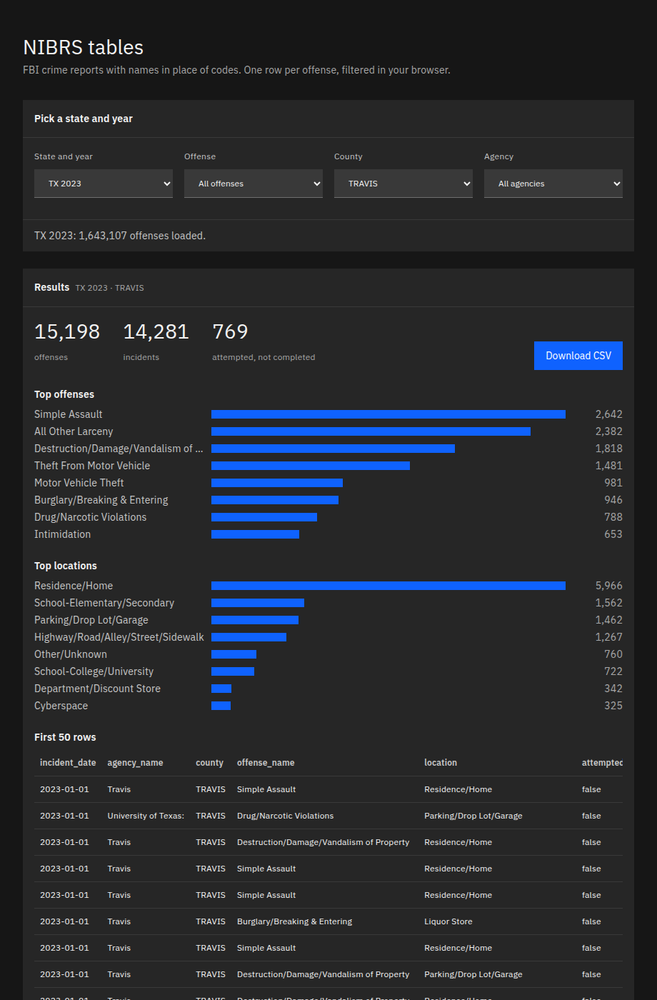

# nibrs-tables

FBI NIBRS crime files as flat tables: offenses, victims, offenders, arrests and property, with names in place of codes.



The FBI publishes each state and year as a zip of about 40 CSV tables. An offense row says `13B` at location `35`; the names sit in other tables. This tool joins them for you.

```
$ nibrs-tables offenses TX 2023 --out tx-2023.parquet
Downloading TX-2023.zip
tx-2023.parquet 1,643,107 rows
```

That run took 29 seconds. Top Texas offenses in 2023: Simple Assault 249,745, All Other Larceny 173,999, Vandalism 167,598.

## Install

```
pip install git+https://github.com/ivanvia7/nibrs-tables
nibrs-tables offenses DE 2023 --out de-2023.csv
```

`--out` writes `.csv`, `.jsonl`, `.db` (SQLite) or `.parquet` (needs the `parquet` extra: `pip install "nibrs-tables[parquet] @ git+https://github.com/ivanvia7/nibrs-tables"`).
`nibrs-tables download DE 2023` saves only the FBI zip. Zips are kept in `cache/` inside the folder you run from, or in `--cache-dir`, so a second run skips the download.

## One row per offense

| Column | Example |
|---|---|
| `state`, `year` | `DE`, `2023` |
| `incident_id`, `offense_id` | FBI ids |
| `incident_date`, `incident_hour` | `2023-01-01`, `2` |
| `ori`, `agency_name`, `county` | `DE0010100`, `Dover`, `KENT` |
| `offense_code`, `offense_name` | `13B`, `Simple Assault` |
| `offense_category`, `crime_against` | `Assault Offenses`, `Person` |
| `attempted` | `false` |
| `location` | `Residence/Home` |

## Victims, offenders, arrests and property

Four more commands write one table each. Every row carries `state`, `year`, `incident_id`, `incident_date` and the agency, so the tables join to offenses on `incident_id`.

| Command | One row per | Main columns |
|---|---|---|
| `victims` | victim | `victim_type`, `age`, `sex`, `race`, `ethnicity`, `resident_status`, `offenses`, `injuries`, `relationships` |
| `offenders` | offender | `age`, `sex`, `race`, `ethnicity` |
| `arrestees` | arrest | `arrest_date`, `arrest_type`, `offense_name`, `age`, `sex`, `race`, `ethnicity` |
| `property` | item | `loss_type`, `description`, `value` in dollars, `date_recovered` |

A victim's `offenses`, `injuries` and `relationships` list every match, joined by `; `. Texas 2025 has 1,531,445 victims, 1,538,228 offenders, 355,998 arrests and 1,344,095 property items.

Blank means the FBI file has no value: society as a victim has no age, and some states send no offender ethnicity.

## What it handles

- Every year from 1997 to 2025 tested on real FBI files: the folder inside the zip moves, headers change case, the agency table is `cde_agencies.csv` before 2016, and offenses link by `offense_type_id` before 2023 and `offense_code` after.
- Dates: `09-AUG-16` becomes `2016-08-09`.
- Codes are read from each zip's own tables, because a location id can mean a different place in another year.
- Offenses whose agency is missing from the FBI agencies table are kept with blank agency fields (45 incidents in Texas 2023).

## Web page

Live at https://ivanvia7.github.io/nibrs-tables/ with every state and year the FBI publishes, 1997 to 2025. Older years cover fewer states, because states joined NIBRS over time.

`web/` is a static page that filters a Parquet file in the browser with DuckDB. To run it locally:

```
uv run --extra parquet python scripts/build_web_data.py DE-2023 TX-2023
python3 -m http.server 8765 --directory web
```

## Source

FBI Crime Data Explorer, NIBRS state-year downloads. Not affiliated with the FBI.

## License

MIT
