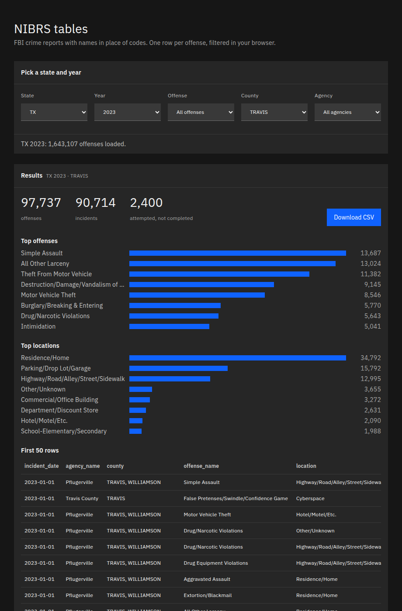

# nibrs-tables

FBI NIBRS crime files as flat tables: offenses, victims, offenders, arrests and property, with names in place of codes.

For reporters, researchers and city analysts who want to count crimes by type, place or agency without joining FBI tables by hand.



The FBI publishes each state and year as a zip of about 40 CSV tables. An offense row says `13B` at location `35`; the names sit in other tables. This tool joins them for you.

```
$ nibrs-tables offenses TX 2023 --out tx-2023.parquet
Downloading TX-2023.zip
tx-2023.parquet 1,643,107 rows
```

That run took 47 seconds with the download and peaked at 1.6 GB of memory. Top Texas offenses in 2023: Simple Assault 249,745, All Other Larceny 173,999, Destruction/Damage/Vandalism of Property 167,598.

The FBI download API drops connections under heavy parallel use; the tool tries the request for the download link 4 times, and a cached zip skips the download.

## Install

```
pip install git+https://github.com/ivanvia7/nibrs-tables
nibrs-tables offenses DE 2023 --out de-2023.csv
```

`--out` writes `.csv`, `.jsonl`, `.db` (SQLite) or `.parquet` (needs the `parquet` extra: `pip install "nibrs-tables[parquet] @ git+https://github.com/ivanvia7/nibrs-tables"`).
`nibrs-tables download DE 2023` saves only the FBI zip. Zips are kept in `cache/` inside the folder you run from, or in `--cache-dir`, so a second run skips the download.

## One row per offense

| Column | Example |
|---|---|
| `state`, `year` | `DE`, `2023` |
| `incident_id`, `offense_id` | FBI ids |
| `incident_date`, `incident_hour` | `2023-01-01`, `2` |
| `ori`, `agency_name`, `county` | `DE0010100`, `Dover`, `KENT` |
| `offense_code`, `offense_name` | `13B`, `Simple Assault` |
| `offense_category`, `crime_against` | `Assault Offenses`, `Person` |
| `attempted` | `false` |
| `location_code`, `location` | `20`, `Residence/Home` |

## Victims, offenders, arrests and property

Four more commands write one table each. Every row carries `state`, `year`, `incident_id`, `incident_date` and the agency, so the tables join to offenses on `incident_id`.

| Command | One row per | Main columns |
|---|---|---|
| `victims` | victim | `victim_type`, `age`, `sex`, `race`, `ethnicity`, `resident_status`, `offenses`, `injuries`, `relationships` |
| `offenders` | offender | `age`, `sex`, `race`, `ethnicity` |
| `arrestees` | arrest | `arrest_date`, `arrest_type`, `offense_name`, `age`, `sex`, `race`, `ethnicity` |
| `property` | item | `loss_type`, `description`, `value` in dollars, `date_recovered` |

A victim's `offenses`, `injuries` and `relationships` list every match, joined by `; `. Texas 2025 has 1,531,445 victims, 1,538,228 offenders, 355,998 arrests and 1,344,095 property items.

Blank means the FBI file has no value: society as a victim has no age, and some states send no offender ethnicity.

## What it handles

- Every year from 1997 to 2025 tested on real FBI files: the folder inside the zip moves, headers change case, the agency table is `cde_agencies.csv` before 2016, and offenses link by `offense_type_id` before 2023 and `offense_code` after.
- Dates: `09-AUG-16` becomes `2016-08-09`.
- Codes are read from each zip's own tables, because a location id can mean a different place in another year.
- Names follow each year's FBI table, so some change over time: location `13` is `Highway/Road/Ally` in 2005 and `Highway/Road/Alley/Street/Sidewalk` in 2023. Group stacked years by `offense_code` and `location_code`.
- `agency_name` adds the FBI unit, so campuses stay apart (`University of Texas: Austin`), and county agencies end in `County`, so Austin police (`Austin`) and the Austin County sheriff (`Austin County`) do too.
- Offenses whose agency is missing from the FBI agencies table are kept with blank agency fields (45 incidents in Texas 2023).
- An offense that points to a missing incident, offense type or location is skipped, and the run prints how many. If every offense is skipped, or the table has none, the run fails and keeps the old output file.

## Checked against the FBI files

`scripts/check_sample.py` decodes offenses a second way, with plain `csv` and the zip's own code tables, and compares that to the tool. It runs on every state and year the web page builds.

```
$ uv run python scripts/check_sample.py DE-2005 DE-2016 DE-2023 TX-2023
DE-2005: 89,182 raw offenses, 20 sampled, 0 problems
DE-2016: 79,533 raw offenses, 20 sampled, 0 problems
DE-2023: 62,938 raw offenses, 20 sampled, 0 problems
TX-2023: 1,643,107 raw offenses, 20 sampled, 0 problems
```

Every raw offense row comes out exactly once, and each sampled row matches on code, name, category, location and the attempted flag.

## Web page

Live at https://ivanvia7.github.io/nibrs-tables/ with every state and year the FBI publishes, 1997 to 2025. Older years cover fewer states, because states joined NIBRS over time.

Picking a county includes agencies that cover it along with others: TRAVIS includes Austin police, filed by the FBI under `HAYS, TRAVIS, WILLIAMSON`.

`web/` is a static page that filters a Parquet file in the browser with DuckDB. To run it locally:

```
uv run --extra parquet python scripts/build_web_data.py DE-2023 TX-2023
python3 -m http.server 8765 --directory web
```

## Source

FBI Crime Data Explorer, NIBRS state-year downloads. Not affiliated with the FBI.

## License

MIT
